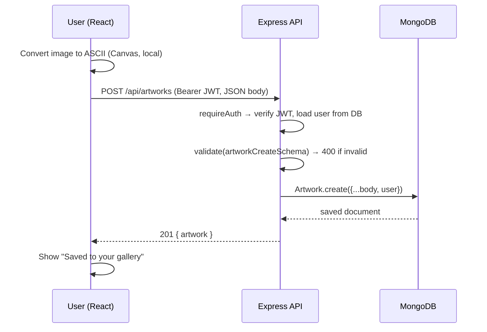
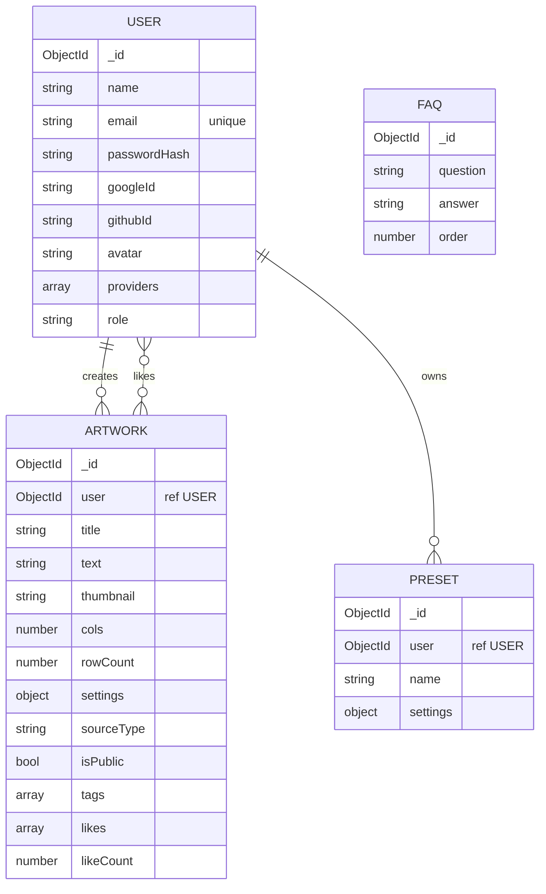

# ASCII_CAM — Live ASCII Art Converter (MERN Stack)

> Convert your **camera, videos and images** to live ASCII art, save it to a **MongoDB-backed gallery**, share it **publicly**, and keep your favourite settings as **presets**.

**Stack:** React 18 (TypeScript, Vite, Tailwind) → Node.js + Express 4 (REST API) → MongoDB (Mongoose 8)
**Repository:** https://github.com/allenasat044-prog/FSD-PROJECT
**Course:** Full Stack Development (FSD) — MERN project

---

## Table of contents

1. [What the project does](#1-what-the-project-does)
2. [Technology stack](#2-technology-stack)
3. [Architecture and request lifecycle](#3-architecture-and-request-lifecycle)
4. [Folder structure](#4-folder-structure-what-every-file-is-for)
5. [How the ASCII conversion works](#5-how-the-ascii-conversion-works)
6. [Database design (MongoDB)](#6-database-design-mongodb)
7. [REST API reference](#7-rest-api-reference)
8. [Authentication (JWT, bcrypt, Google/GitHub)](#8-authentication)
9. [Validation and error handling](#9-validation-and-error-handling)
10. [Frontend walkthrough](#10-frontend-walkthrough)
11. [Security measures](#11-security-measures)
12. [Testing](#12-testing)
13. [Setup and running](#13-setup-and-running)
14. [**Team roles — what each member owns and must know**](#14-team-roles--what-each-member-owns-and-must-know)
    - [14.1 Pankaj Pandurang Tike — React Frontend](#141-pankaj-pandurang-tike--react-frontend)
    - [14.2 Shashank Patel — Express / Node.js Backend & APIs](#142-shashank-patel--express--nodejs-backend--apis)
    - [14.3 Rishu Gupta — MongoDB & Database](#143-rishu-gupta--mongodb--database)
    - [14.4 Priyanshu Kumar — Authentication, Integration, Testing & Deployment](#144-priyanshu-kumar--authentication-integration-testing--deployment)
    - [14.5 How the four roles depend on each other](#145-how-the-four-roles-depend-on-each-other)
15. [Everyone must know: the full flow](#15-everyone-must-know-the-full-flow)
16. [Project vs. the course guide — differences to be ready to explain](#16-project-vs-the-course-guide--differences-to-be-ready-to-explain)
17. [Known limitations and future work](#17-known-limitations-and-future-work)
18. [Pre-submission checklist](#18-pre-submission-checklist)

---

## 1. What the project does

ASCII_CAM turns visual input into text-art in real time. A user can:

| Feature | What happens | Where it runs |
|---|---|---|
| **Convert** a webcam feed, video file or image | Each frame is sampled, brightness is mapped to a character, and the result is painted on a canvas | **Browser only** (Canvas API) — nothing is uploaded |
| **Tune** the result | Resolution (20–500 columns), contrast, brightness, 5 character sets, 3 colour modes, invert, mirror | Browser |
| **Export** | PNG, JPG, WEBP, SVG, plain TXT, or copy to clipboard | Browser |
| **Register / log in** | Email + password (bcrypt + JWT), or Google / GitHub sign-in | Browser → API → MongoDB |
| **Save to gallery** | Stores the ASCII text, a small thumbnail, the settings and metadata | API → MongoDB |
| **Manage gallery** | List, search, filter, sort, paginate, rename, make public/private, delete | API → MongoDB |
| **Share publicly** | A public artwork is visible to anyone at `/gallery/:id` without logging in | API → MongoDB |
| **Like** | Signed-in users can like public art; "Most liked" sorting; "Liked" tab | API → MongoDB |
| **Presets** | Save the current settings under a name and re-apply them in one click | API → MongoDB |
| **FAQ** | The FAQ page is read from the database | API → MongoDB |

**Why this is a true full-stack app:** the React UI never touches the database. Every login, save, list, edit, delete, like and preset goes through the Express REST API, which validates the request, checks the user's JWT, and reads/writes MongoDB through Mongoose.

---

## 2. Technology stack

| Layer | Technology | Used for |
|---|---|---|
| Frontend | React 18, TypeScript, Vite 5, Tailwind CSS 3, `react-router-dom` 6, `lucide-react`, Radix UI (accordion) | UI, routing, state, the Canvas ASCII engine, calling the API with `fetch` |
| Backend | Node.js ≥ 18 (ES modules), Express 4 | REST API, routing, middleware, business logic |
| Database | MongoDB 7 + Mongoose 8 (local Docker or Atlas) | Persistent storage: users, artworks, presets, FAQs |
| Auth | `jsonwebtoken`, `bcryptjs`, plain OAuth 2.0 (Google, GitHub) | Login, password hashing, stateless sessions |
| Validation | **Zod** | Request body and query validation |
| Security | `helmet`, `cors`, `express-rate-limit` | Secure headers, origin allow-list, brute-force limit |
| Testing | Node's built-in test runner + `supertest` | API tests |
| Tooling | `concurrently`, Docker Compose (MongoDB only) | One command to run both servers; local database |

---

## 3. Architecture and request lifecycle

```
 React (client/)                Express (server/)                       MongoDB
┌────────────────────┐  REST   ┌───────────────────────────────┐ Mongoose ┌─────────────┐
│ Pages & components │ ──────► │ helmet → cors → json parser   │ ───────► │ users       │
│ lib/api.ts (JWT)   │ ◄────── │ → routes → middleware         │ ◄─────── │ artworks    │
│ Canvas ASCII engine│  JSON   │   (auth, validate)            │          │ presets     │
└────────────────────┘         │ → controllers → errorHandler  │          │ faqs        │
                               └───────────────────────────────┘          └─────────────┘
```

The frontend **never** talks to the database. In development Vite proxies `/api` to `http://localhost:5001`; in production `VITE_API_URL` points to the deployed API.



### Middleware order in `server/src/app.js` (order matters)

1. `helmet()` — secure HTTP headers
2. `cors({ origin: env.clientOrigin })` — only the configured front-end origin(s) may call the API from a browser
3. `express.json({ limit: "6mb" })` — parse JSON bodies (6 MB because ASCII text + thumbnail can be large)
4. `GET /api/health` — reports API and DB connection status
5. `rateLimit` on `/api/auth` — 100 requests per 15 minutes per client
6. Resource routers: `/api/auth`, `/api/artworks`, `/api/presets`, `/api/faqs`
7. `notFound` — turns unknown routes into a JSON 404
8. `errorHandler` — **must be last**; formats every error the same way

`server.js` connects to MongoDB and seeds the FAQs **before** calling `app.listen`, so the API only starts if the database is reachable. `app.js` exports the Express `app` without listening, which is what lets the tests use Supertest without opening a port.

---

## 4. Folder structure (what every file is for)

```
project-root/
├── package.json              # root scripts: install:all, dev (runs both), test, build
├── docker-compose.yml        # starts MongoDB 7 only (port 27017, named volume)
├── docs/
│   ├── PROJECT_DOCUMENTATION.md   # earlier documentation (ER diagram, viva questions)
│   └── screenshots/               # (empty — add your screenshots here)
│
├── client/                   # ── React frontend (Vite + TypeScript + Tailwind)
│   ├── vite.config.ts        # "@" alias → src; dev proxy /api → localhost:5001
│   ├── tailwind.config.js    # theme tokens (shadcn-style CSS variables)
│   ├── .env.example          # VITE_API_URL (empty in dev, API URL in production)
│   └── src/
│       ├── main.tsx          # mounts <App/> in React.StrictMode
│       ├── App.tsx           # <AuthProvider> + <BrowserRouter> + all <Route>s
│       ├── index.css         # Tailwind layers + CSS variables
│       ├── lib/
│       │   ├── api.ts        # THE API client: fetch wrapper, token storage, typed endpoints
│       │   ├── ascii.ts      # THE conversion engine: charsets, renderAscii(), SVG export
│       │   └── utils.ts      # cn() class-name helper
│       ├── context/AuthContext.tsx   # user + token state shared by the whole app
│       ├── components/
│       │   ├── Navbar.tsx            # nav links, login/signup/logout buttons
│       │   ├── LikeButton.tsx        # optimistic like toggle
│       │   ├── TeamSection.tsx       # "Meet the team" cards on the FAQ page
│       │   ├── ascii/AsciiDashboard.tsx  # the converter screen (camera/video/image)
│       │   ├── ascii/SavePanel.tsx       # "Save to gallery" form → POST /artworks
│       │   ├── ascii/PresetPanel.tsx     # presets → /presets
│       │   └── ui/                       # hero, feature cards, FAQ accordion, button
│       └── pages/
│           ├── Gallery.tsx       # public / my creations / liked; search, filter, sort, pagination
│           ├── ArtworkPage.tsx   # one artwork, full size (/gallery/:id)
│           ├── AuthPage.tsx      # one component for both /login and /signup
│           ├── AuthCallback.tsx  # receives the token after Google/GitHub sign-in
│           ├── FaqPage.tsx       # FAQs from GET /api/faqs (+ TeamSection)
│           └── NotFound.tsx
│
└── server/                   # ── Node + Express backend (ES modules)
    ├── .env.example          # every environment variable, documented
    ├── src/
    │   ├── server.js         # connect DB → seed FAQs → app.listen
    │   ├── app.js            # builds the Express app + middleware chain
    │   ├── validators.js     # all Zod schemas
    │   ├── config/
    │   │   ├── env.js        # reads process.env once, applies defaults
    │   │   └── db.js         # mongoose.connect + human-readable error hints
    │   ├── models/           # User.js, Artwork.js, Preset.js, Faq.js
    │   ├── routes/           # auth.js, artworks.js, presets.js, faqs.js
    │   ├── controllers/      # auth.js, oauth.js, artworks.js, presets.js
    │   ├── middleware/       # auth.js (JWT), validate.js (Zod), error.js (central errors)
    │   └── seed/             # faqs.js (auto on start), gallery.js (optional demo art)
    └── tests/                # api.test.js (no DB), crud.test.js (needs MongoDB)
```

**Pattern:** `routes → middleware → controllers → models → MongoDB` (MVC-style). Routes only say *which URL and which middleware*, controllers hold the logic, models define the data.

---

## 5. How the ASCII conversion works

All of this is in `client/src/lib/ascii.ts` and runs **in the browser**, which is why live preview needs no backend.

1. **Pick the output grid.** The user chooses `cols` (columns). The number of rows is computed so the picture is not stretched:
   `rowCount = round(cols × h × CW / (w × CH))`, where `CW = 6` and `CH = 12` are the character-cell width/height in pixels. Characters are about twice as tall as wide, so rows are halved relative to columns.
2. **Down-sample.** The source (video frame or image) is drawn onto a small off-screen canvas that is only `cols × rowCount` pixels. Each pixel now represents one future character. If *mirror* is on, the canvas is flipped horizontally.
3. **Read the pixels** with `getImageData`.
4. **Compute brightness** for each pixel using the luma formula `0.299·R + 0.587·G + 0.114·B` (green counts most because the eye is most sensitive to it), normalised to 0–1.
5. **Apply controls:** `l = (l − 0.5) × contrast + 0.5 + brightness`, clamp to 0–1, and if *invert* is on use `1 − l`.
6. **Map to a character:** `char = charset[round(l × (charset.length − 1))]`. Charsets are ordered dark → light:
   `detailed` (70 levels), `classic` (` .:-=+*#%@`), `blocks` (` ░▒▓█`), `binary` (` 01`), `matrix` (katakana + digits).
7. **Paint** the characters on the visible canvas in phosphor green, amber, or **true colour** (each character takes its source pixel's colour).
8. **Export** from the same data: canvas → PNG/JPG/WEBP via `toBlob`; `frameToSvg()` builds an SVG string; TXT is `rows.join("\n")`.

**Performance trick for live sources** (`AsciiDashboard.tsx`): the render loop uses `requestAnimationFrame`. If one frame takes more than 15 ms, the effective resolution is reduced by 10% (minimum 40 columns); if it takes under 8 ms it increases again (up to the chosen value). That is how it holds a smooth frame rate. Still images always render at the full chosen resolution.

**Why `useRef` and not `useState` for the loop:** values like the current frame, effective column count and settings change ~60 times per second. Storing them in state would re-render React 60 times per second; refs change without re-rendering.

---

## 6. Database design (MongoDB)



| Collection | Important fields | Rules / indexes |
|---|---|---|
| **users** | `name` (2–50), `email`, `passwordHash`, `googleId`, `githubId`, `avatar`, `providers[]`, `role` (`user`/`admin`) | `email` **unique** + lowercase; `passwordHash` has `select: false` (never loaded by default) and is deleted in `toJSON`; `googleId`/`githubId` are sparse indexes; `passwordHash` is absent for social-only accounts |
| **artworks** | `user` (ref), `title` (≤80), **`text`** (the ASCII art), `thumbnail` (data-URL), `cols`, `rowCount`, `settings{…}` (embedded sub-document), `sourceType` (`camera`/`video`/`image`), `isPublic`, `tags[]`, `likes[]` (user ids), `likeCount` | Indexes: `{user, createdAt}`, `{isPublic, createdAt}`, `{isPublic, likeCount, createdAt}`, `{isPublic, tags}` — one per list query |
| **presets** | `user` (ref), `name` (≤40), `settings{…}` | **Unique compound index `{user, name}`** → one preset name per user (duplicate → 11000 → HTTP 409) |
| **faqs** | `question`, `answer`, `order` | Seeded automatically on first start if the collection is empty |

### Design decisions you should be able to justify

- **Reference vs. embed.** Artworks and presets *reference* the user by `ObjectId` (a user has many artworks, and the user can change independently). The `settings` object is *embedded* because it is always read together with its artwork and never queried alone.
- **`likes[]` plus `likeCount`.** `likes` stores *who* liked (so one user can only like once and the UI can show "liked by me"). `likeCount` is a *denormalised* counter so "Most liked" sorting is a plain indexed sort instead of computing array lengths.
- **`text` excluded from list queries** (`.select("-text")`). A 500-column piece can be 100 KB+; a page of 12 would be over 1 MB. The list needs only the thumbnail; the full text is returned only by `GET /api/artworks/:id`.
- **Limits:** a MongoDB document may be 16 MB; the API caps `text` at 300 000 characters and the JSON body at 6 MB.
- **Schema-level validation** (`required`, `enum`, `min`/`max`, `maxlength`) is the *last line of defence* behind Zod.

### Mongoose operations used (and the MongoDB shell equivalent)

| Purpose | Code in project | Shell equivalent |
|---|---|---|
| Create | `Artwork.create({...})` | `db.artworks.insertOne({...})` |
| List + filter + sort + page | `Artwork.find(filter).sort(order).skip().limit()` | `db.artworks.find(filter).sort().skip().limit()` |
| Count for pagination | `Artwork.countDocuments(filter)` | `db.artworks.countDocuments(filter)` |
| Join author name | `.populate("user", "name")` | `$lookup` |
| Update (owner only) | `findOneAndUpdate({_id, user}, body, {new:true, runValidators:true})` | `updateOne({_id, user}, {$set})` |
| Delete (owner only) | `findOneAndDelete({_id, user})` | `deleteOne({_id, user})` |
| Like | `{ $addToSet: {likes: uid}, $inc: {likeCount: 1} }` | same operators |
| Unlike | `{ $pull: {likes: uid}, $inc: {likeCount: -1} }` | same operators |
| Search by title | `new RegExp(escapeRegex(search), "i")` | `{title: {$regex, $options:"i"}}` |

---

## 7. REST API reference

**Base URL:** `http://localhost:5001/api` · **Format:** JSON · **Auth:** `Authorization: Bearer <token>`

| Method | Endpoint | Auth | Purpose | Success | Typical errors |
|---|---|---|---|---|---|
| GET | `/health` | – | API + DB status | 200 | – |
| POST | `/auth/register` | – | Create account `{name,email,password}` | 201 `{token,user}` | 400, 409 |
| POST | `/auth/login` | – | Log in `{email,password}` | 200 `{token,user}` | 400, 401 |
| GET | `/auth/me` | ✔ | Current user | 200 `{user}` | 401 |
| GET | `/auth/providers` | – | Which social buttons to show | 200 `{google,github}` | – |
| GET | `/auth/google`, `/auth/github` | – | Start social sign-in (redirect) | 302 | 501 if not configured |
| GET | `/auth/google/callback`, `/auth/github/callback` | – | Finish social sign-in (redirect to client) | 302 | – |
| GET | `/artworks` | optional | List. Query: `scope=public\|mine\|liked`, `page`, `limit` (≤50), `search`, `sort=new\|top`, `source`, `tag` | 200 `{items,page,limit,total,pages}` | 400, 401 |
| GET | `/artworks/:id` | optional | One artwork incl. `text`. Private → owner only | 200 `{artwork}` | 400, 404 |
| POST | `/artworks` | ✔ | **Create** | 201 `{artwork}` | 400, 401, 413 |
| PATCH | `/artworks/:id` | ✔ owner | **Update** `title` / `isPublic` / `tags` | 200 `{artwork}` | 400, 401, 404 |
| DELETE | `/artworks/:id` | ✔ owner | **Delete** | 204 | 401, 404 |
| POST | `/artworks/:id/like` | ✔ | Toggle like | 200 `{liked,likeCount}` | 401, 404 |
| GET | `/presets` | ✔ | List my presets | 200 `{items}` | 401 |
| POST | `/presets` | ✔ | Create `{name,settings}` | 201 `{preset}` | 400, 409 |
| PUT | `/presets/:id` | ✔ | Replace preset | 200 `{preset}` | 400, 404 |
| DELETE | `/presets/:id` | ✔ | Delete preset | 204 | 404 |
| GET | `/faqs` | – | FAQ list | 200 `{items}` | – |

**Status codes used:** 200 OK · 201 Created · 204 No Content · 400 Bad Request (validation/bad id/bad JSON) · 401 Unauthorized (no/bad/expired token, wrong password) · 404 Not Found · 409 Conflict (duplicate email / preset name) · 413 Payload Too Large · 501 Not Implemented (social login not configured) · 500 Server Error.

**Consistent error shape:**
```json
{ "error": { "message": "Validation failed",
             "details": [ { "field": "email", "message": "Enter a valid email" } ] } }
```

**Example — create an artwork**
```http
POST /api/artworks
Authorization: Bearer eyJhbGciOi...
Content-Type: application/json

{ "title": "Me, 2026", "text": "@@%%\n##**", "cols": 4, "rowCount": 2,
  "settings": { "cols": 120, "contrast": 1.2, "brightness": 0, "charset": "detailed",
                "mode": "green", "invert": false, "mirror": true },
  "sourceType": "camera", "isPublic": true, "tags": ["selfie"] }

→ 201 { "artwork": { "_id": "…", "title": "Me, 2026", "isPublic": true, "likeCount": 0, "likedByMe": false, … } }
```

---

## 8. Authentication

### 8.1 Email + password

1. **Register** (`controllers/auth.js`): Zod validates → reject with 409 if the email exists → `bcrypt.hash(password, 10)` → store only `passwordHash` → return `{ token, user }`.
2. **Login:** find user by email with `.select("+passwordHash")` → `bcrypt.compare` → on failure the **same message** ("Incorrect email or password") is used whether the email or the password was wrong, so attackers cannot discover which emails exist.
3. **Token:** `jwt.sign({ sub: userId }, JWT_SECRET, { expiresIn: "7d" })`. A JWT is `header.payload.signature`; the signature proves the token was issued by this server and not altered. The payload is *encoded, not encrypted*, so it holds only the user id.
4. **Client:** `lib/api.ts` stores the token in `localStorage` (key `ascii_cam_token`) and adds `Authorization: Bearer <token>` to every request.
5. **Server:** `middleware/auth.js` reads the header → `jwt.verify` → loads the user from MongoDB (so a deleted user's token stops working) → attaches `req.user`.
   - `requireAuth` → 401 if there is no valid user.
   - `optionalAuth` → continues anonymously if there is no token, but still identifies the user if there is one (used on public gallery routes so `likedByMe` and owner-only visibility work).
6. **Staying logged in after refresh:** `AuthContext` calls `GET /auth/me` on startup if a token exists; if that fails, the token is cleared.

### 8.2 Google / GitHub sign-in (optional)

Implemented with the plain OAuth 2.0 *authorization-code flow* using Node's built-in `fetch` — no Passport library.

```
Browser ─ GET /api/auth/google ─────────► Express: redirect to Google (with signed `state`)
Google ─ user approves ─ redirect ──────► GET /api/auth/google/callback?code=…&state=…
Express: verify state → exchange code for access token → read profile
         → find user by googleId, else by email (link accounts), else create
         → redirect to  <CLIENT>/auth/callback#token=<jwt>
React AuthCallback: read token from URL hash → remove it from the address bar → GET /auth/me → go to /explore
```

- Buttons only appear if the keys exist in `.env` (`GET /auth/providers` tells the client).
- The token is sent in the URL **hash** (`#token=`) because hashes are not sent to servers or logged.
- The `state` parameter is a short-lived signed JWT used as an anti-CSRF token.
- Accounts with the same verified email are linked to one user (`providers: ["password","google"]`).

### 8.3 Authorisation (who may do what)

- Create / update / delete artworks and presets → must be logged in.
- **Ownership is enforced inside the database query** — `findOneAndUpdate({ _id, user: req.user._id })`. User A cannot edit or delete user B's art because the filter simply matches nothing and a 404 is returned.
- A private artwork requested by a stranger returns **404, not 403**, so its existence is not revealed.

---

## 9. Validation and error handling

| Layer | Where | What it checks |
|---|---|---|
| **Client** | HTML attributes in `AuthPage` (`required`, `minLength`, `type="email"`) and checks in `SavePanel`/`PresetPanel` | Fast feedback before any request |
| **Server (Zod)** | `validators.js` + `middleware/validate.js` | Email format; password 8–72 chars; title 1–80; `cols` 20–500; contrast 0.3–3; brightness −0.5–0.5; enums for charset/mode/sourceType; thumbnail must start with `data:image/`; update body needs ≥ 1 field; list query values are coerced and capped |
| **Database (Mongoose)** | models | `required`, `enum`, `min`/`max`, `maxlength`, unique indexes |

`validate(schema, "body" | "query")` parses the request and **replaces** it with the cleaned value (trimmed, lower-cased email, defaults applied, numbers coerced). If parsing fails Zod throws, and Express forwards it to the error handler.

**Central error handler** (`middleware/error.js`) maps everything to one JSON shape:

| Error | Becomes |
|---|---|
| `ZodError` | 400 + per-field `details` |
| Mongoose `CastError` (bad ObjectId) | 400 "Invalid id" |
| Mongoose `ValidationError` | 400 |
| Mongo duplicate key `code 11000` | 409 |
| `JsonWebTokenError` / `TokenExpiredError` | 401 |
| Body too large / malformed JSON | 413 / 400 |
| Anything else | 500 with a **generic** message (the real error is only logged — no leaking internals) |

`asyncHandler(fn)` wraps each async controller so a rejected promise is passed to `next(err)` automatically — controllers need no `try/catch`.

On the frontend, `api.ts` converts failures into an `ApiError` (including "Cannot reach the server. Is the backend running?" when `fetch` itself fails) and `errorText()` formats the message and field details for display.

---

## 10. Frontend walkthrough

### Routes (`App.tsx`)

| URL | Component | Needs login? |
|---|---|---|
| `/` | Parallax hero + feature cards | No |
| `/explore` | `AsciiDashboard` (converter) | No — converting is free; *saving* needs login |
| `/gallery` | `Gallery` | Public tab no; "My creations" and "Liked" yes |
| `/gallery/:id` | `ArtworkPage` | Only for private art (owner) |
| `/faq` | `FaqPage` (+ `TeamSection`) | No |
| `/login`, `/signup` | `AuthPage` (`mode` prop) | – |
| `/auth/callback` | `AuthCallback` | – |
| `*` | `NotFound` | – |

### State management

- **Global state:** only the logged-in user, via **Context API** (`AuthContext` → `useAuth()` exposes `user`, `loading`, `login`, `register`, `loginWithToken`, `logout`).
- **Local state:** `useState` in each page (gallery filters, form fields, messages, loading and error flags).
- **Non-render state:** `useRef` (camera stream, current frame, effective resolution, FPS counter).
- **Side effects:** `useEffect` for data fetching, the render loop, and cleanup (stopping the camera on unmount).
- **Protecting actions:** instead of a `<ProtectedRoute>` wrapper, components receive an `onNeedAuth` callback that navigates to `/login` and remembers the page in `location.state.from`; after login `AuthPage` returns the user there. The **real** protection is on the server (401).

### Key behaviours worth knowing

- **Optimistic UI** in `LikeButton`: the heart and count change instantly, then are corrected from the server response or rolled back on failure.
- **Gallery** rebuilds its query from `scope/page/sort/search/source/tag`, and resets to page 1 whenever a filter changes.
- **Snapshot for saving:** `AsciiDashboard.snapshot()` takes the current frame's text, makes a ≤ 320 px JPEG thumbnail from the canvas, and passes the settings + source type to `SavePanel`.
- **FAQ fallback:** if the API is offline, `faqs-02.tsx` shows built-in default FAQs.

---

## 11. Security measures

| Measure | Where |
|---|---|
| Passwords hashed with bcrypt (10 rounds); never stored or returned | `controllers/auth.js`, `User` model |
| JWT signed with `JWT_SECRET`, expires in 7 days | `middleware/auth.js` |
| Ownership checks inside queries | `controllers/artworks.js`, `presets.js` |
| Private art hidden with 404 | `getOne`, `toggleLike` |
| Zod validation + Mongoose schema rules | `validators.js`, `models/` |
| User-typed search text is regex-escaped (prevents regex injection / ReDoS) | `escapeRegex` in `controllers/artworks.js` |
| `helmet` headers, CORS allow-list, rate limit on `/api/auth`, 6 MB body cap | `app.js` |
| Generic 500 messages | `middleware/error.js` |
| `.env` in `.gitignore`; secrets only in environment variables | `.gitignore`, `config/env.js` |

---

## 12. Testing

```bash
npm test                       # runs both files below
```

| File | Needs MongoDB? | Covers |
|---|---|---|
| `server/tests/api.test.js` | No | Health check, JSON 404, validation errors (400), malformed JSON, all protected routes return 401 without a token, bad token → 401 |
| `server/tests/crud.test.js` | **Yes** — set `MONGO_URI_TEST` | Register, duplicate email 409, wrong password 401, login; artwork create/read/update/delete; private-art visibility; likes toggle, `liked` scope, sorting and filters; preset create, duplicate 409, delete |

Run the full test with a database:
```bash
docker compose up -d
MONGO_URI_TEST=mongodb://127.0.0.1:27017/ascii_cam_test npm test
```
> The CRUD test **drops the test database** before it runs — never point `MONGO_URI_TEST` at your real data.

Result when checked on this zip without a database: **6 passed, 1 skipped** (the skipped one is the CRUD test, which needs `MONGO_URI_TEST`).

Manual testing: Postman/Thunder Client for each endpoint (success, invalid input, missing token, wrong id), MongoDB Compass to see the saved documents, and the browser DevTools Network tab for the end-to-end flow.

---

## 13. Setup and running

**Needs:** Node.js 18+, and MongoDB (Docker, local install, or a free MongoDB Atlas cluster).

```bash
# 1. Database (pick one)
docker compose up -d                      # local MongoDB on 27017
#   or use an Atlas connection string in server/.env

# 2. Environment
cp server/.env.example server/.env        # then edit values (see below)

# 3. Install everything (root + server + client)
npm run install:all

# 4. Run API (http://localhost:5001) and React (http://localhost:5173) together
npm run dev

# Optional: demo art in the public gallery
npm --prefix server run seed:gallery
```

Check `http://localhost:5001/api/health` → `{"status":"ok","db":"connected"}`.

### Environment variables — `server/.env`

| Variable | Meaning | Default |
|---|---|---|
| `PORT` | API port (5001 because macOS reserves 5000 for AirPlay) | 5001 |
| `MONGO_URI` | `mongodb://127.0.0.1:27017/ascii_cam` or the Atlas `mongodb+srv://…` string (URL-encode special characters in the password, e.g. `@` → `%40`) | local DB |
| `JWT_SECRET` | Long random string used to sign tokens. **Must be set in production** | `dev-only-secret` |
| `JWT_EXPIRES` | Token lifetime | `7d` |
| `CLIENT_ORIGIN` | Allowed front-end origin(s), comma-separated (CORS + OAuth redirect) | `http://localhost:5173` |
| `SERVER_URL` | Public URL of the API (used to build OAuth callback URLs) | `http://localhost:<PORT>` |
| `GOOGLE_CLIENT_ID/SECRET`, `GITHUB_CLIENT_ID/SECRET` | Optional; the matching button appears only when both values are set | empty |

`client/.env`: `VITE_API_URL` — leave empty in development (Vite proxies `/api`); in production set it to the deployed API, e.g. `https://your-api.onrender.com/api`.

### Scripts

| Command | What it does |
|---|---|
| `npm run dev` | API + React dev servers together |
| `npm test` | API tests |
| `npm run build` | Type-check and build the React app (`client/dist`) |
| `npm --prefix server run seed:gallery` | Add 6 generated demo artworks (safe to run twice) |

---

# 14. Team roles — what each member owns and must know

The course guide says every student must **explain their own role**, answer questions on React, Express/Node, REST, MongoDB and the architecture, **and** understand the complete flow. Each section below lists *what that person built*, *the files they should open and be able to walk through*, *the concepts behind them*, and *likely questions with model answers*.

| Member | Role | Main folders / files |
|---|---|---|
| **Pankaj Pandurang Tike** | React Frontend Development | `client/src/components/*`, `pages/*`, `App.tsx`, `lib/ascii.ts`, styling |
| **Shashank Patel** | Express / Node.js Backend & APIs | `server/src/app.js`, `server.js`, `routes/*`, `controllers/artworks.js` + `presets.js`, `middleware/error.js` + `validate.js`, `validators.js`, `config/env.js` |
| **Rishu Gupta** | MongoDB & Database | `server/src/models/*`, `config/db.js`, `seed/*`, database queries inside the controllers, `docker-compose.yml` |
| **Priyanshu Kumar** | Auth, Integration, Testing & Deployment | `middleware/auth.js`, `controllers/auth.js` + `oauth.js`, `routes/auth.js`, `client/src/lib/api.ts`, `context/AuthContext.tsx`, `AuthPage`/`AuthCallback`, `server/tests/*`, CORS/proxy/env, Git, hosting |

---

## 14.1 Pankaj Pandurang Tike — React Frontend

### One-sentence summary
*"I built everything the user sees and touches: the pages, components, routing, state, the in-browser ASCII engine, and the screens that call the backend APIs."*

### What was built
- **App shell and routing** (`App.tsx`, `main.tsx`): `<AuthProvider>` wraps `<BrowserRouter>`; 9 routes; a `ScrollToTop` helper; shared `Navbar` and `Footer`.
- **Landing page:** parallax hero and animated feature cards (`components/ui/`).
- **Converter dashboard** (`AsciiDashboard.tsx`): tabs for Camera / Video / Image, drag-and-drop, sliders (resolution, contrast, brightness), selects (charset, mode), invert/mirror, download format, copy, camera flip, live FPS/size readout.
- **Conversion engine** (`lib/ascii.ts`): see [section 5](#5-how-the-ascii-conversion-works).
- **Save and presets UI** (`SavePanel.tsx`, `PresetPanel.tsx`).
- **Gallery** (`Gallery.tsx`): scope tabs, search, source filter, sort, tag chips, pagination, rename / make public / delete, loading / error / empty states.
- **Artwork page** (`ArtworkPage.tsx`), **FAQ page**, **Login/Sign-up form**, **Like button**, **404 page**, **Team section**.
- **Styling:** Tailwind CSS with shadcn-style design tokens; responsive grid layouts.

### Concepts you must know
| Topic | Where it appears in this project |
|---|---|
| **JSX and components** | Every `.tsx` file; reusable `LikeButton`, `Navbar`, `Drop` area |
| **Props** | `onNeedAuth`, `LikeButton`'s `liked / count / onChange`, `PresetPanel`'s `settings / onApply` |
| **`useState`** | Form fields, gallery filters, messages, settings object |
| **`useEffect`** | Fetch gallery on filter change; render loop; cleanup (stop camera); scroll-to-top |
| **`useRef`** | Video/canvas elements, stream, current frame, FPS — values that must not trigger re-renders |
| **`useMemo` / `useCallback`** | Off-screen canvas created once; stable `draw` function |
| **`useContext`** | `useAuth()` reads the user from `AuthContext` |
| **React Router** | `<Routes>/<Route>`, `<NavLink>`, `useParams` (`:id`), `useNavigate`, `useLocation` (`state.from`), `useSearchParams`, `<Navigate>` |
| **Controlled components** | All inputs bound to state with `value` + `onChange` |
| **Conditional rendering** | Logged-in vs logged-out UI; loading / error / empty; `{err && <p/>}` |
| **List rendering with `key`** | `items.map(a => <article key={a._id}>)` |
| **Async/await + try/catch/finally** | Every API call: set loading → await → catch error → finally stop loading |
| **Browser APIs** | `getUserMedia` (camera), `<video>`, `<canvas>`, `FileReader`/`URL.createObjectURL`, `requestAnimationFrame`, Clipboard API |
| **TypeScript basics** | Interfaces (`Artwork`, `Settings`, `Preset`), generics in the API client, union types (`"camera" \| "video" \| "image"`) |
| **Tailwind / responsive design** | Utility classes, `sm:` / `lg:` breakpoints, CSS grid |

### Code you should be able to explain line by line
1. **`Gallery.tsx → load()`** — builds the query from state, sets `loading`, calls `api.listArtworks`, stores `items/pages/total`, handles errors; `useEffect(() => { load(); }, [load])` reruns it when any filter changes.
2. **`AsciiDashboard.tsx` render loop** — `requestAnimationFrame` → if the source is live, `draw()` → `renderAscii()`; why refs are used; the adaptive-resolution rule.
3. **`LikeButton.tsx`** — optimistic update and rollback.
4. **`SavePanel.tsx → save()`** — validates title, cleans tags (lower-case, unique, max 5), calls `api.createArtwork`, shows success or error.
5. **`AuthPage.tsx`** — one component for two modes via the `mode` prop; redirect back via `location.state.from`.

### Likely questions and model answers
- **Why is the camera not sent to the server?** The conversion is done by the Canvas API in the browser. It is faster (no network), private, and the backend is only needed for persistence.
- **Why `useRef` instead of `useState` for the frame?** Changing state re-renders the component; the frame changes about 60 times a second. Refs hold mutable values without re-rendering.
- **What is `key` in a list for?** It lets React identify which items changed, moved or were removed so it updates the DOM efficiently; we use the MongoDB `_id`.
- **What does the `useEffect` cleanup do here?** `useEffect(() => () => stopAll(), [])` stops the camera tracks when the page unmounts, so the camera light does not stay on.
- **How does the UI stay logged in after refresh?** `AuthContext` reads the token from `localStorage` and calls `/auth/me`; on success it sets `user`.
- **How do you handle loading and errors?** Each page has `loading` and `err` state: show "Loading…", show the server's message from `errorText(e)`, and show an empty-state message when the list is empty.
- **How is the frontend separated from the backend?** Separate `client/` folder and package; the only link is HTTP/JSON through `lib/api.ts`. Vite proxies `/api` in development.

### Demo checklist
Landing page → Explore with camera → change charset/contrast → switch to an image → download PNG → save to gallery → Gallery tabs, search, sort → make public → open `/gallery/:id` in a private window.

---

## 14.2 Shashank Patel — Express / Node.js Backend & APIs

### One-sentence summary
*"I built the server: Express setup, the REST endpoints, controllers, middleware, validation and error handling, with consistent status codes and JSON."*

### What was built
- **Server bootstrap:** `server.js` (connect DB → seed → listen) and `app.js` (middleware chain, routers, 404, error handler). `config/env.js` reads environment variables once with defaults.
- **Routes** (`routes/*.js`): URL → middleware → controller wiring. Example: `r.post("/", requireAuth, validate(artworkCreateSchema), c.create)`.
- **Controllers** (`controllers/artworks.js`, `presets.js`): the business logic for every CRUD operation, the gallery list with filters/search/sort/pagination, and the like toggle.
- **Validation** (`validators.js`, `middleware/validate.js`): Zod schemas for every input.
- **Central error handling** (`middleware/error.js`): `AppError`, `asyncHandler`, `notFound`, `errorHandler`.
- **API documentation:** the table in [section 7](#7-rest-api-reference).

### Concepts you must know
| Topic | Where it appears |
|---|---|
| **Node.js runtime, ES modules** | `"type": "module"` in `server/package.json`, `import/export`, top-level `await` in `server.js` |
| **Express app, routers, `req` / `res`** | `app.js`, `routes/*` (`Router()`), `req.params`, `req.query`, `req.body`, `res.status().json()` |
| **Middleware chain** | `(req, res, next)`; order matters; error middleware has **four** parameters and goes last |
| **REST conventions** | Nouns in URLs, verbs for actions: POST create, GET read, PATCH partial update, PUT replace, DELETE remove |
| **Status codes** | See table in section 7 and why each is used |
| **async/await** | Every controller is `async`; `asyncHandler` forwards rejected promises to `next(err)` |
| **Validation with Zod** | `.parse()` throws `ZodError`; `.coerce`, `.default`, `.refine`, `.partial()` |
| **Pagination** | `skip((page-1)*limit).limit(limit)` + `countDocuments` → `pages = ceil(total/limit)` |
| **Env variables / dotenv** | `config/env.js`, `.env.example` |
| **CORS** | `cors({ origin: env.clientOrigin })` — the browser blocks cross-origin calls unless the server allows that origin |
| **Rate limiting & helmet** | `express-rate-limit` on `/api/auth`, `helmet()` headers |

### Code you should be able to explain line by line
1. **The create flow:** `POST /api/artworks` → `requireAuth` → `validate(artworkCreateSchema)` → `c.create` → `Artwork.create({ ...req.body, user: req.user._id })` → `201`.
   Point out that `user` comes from the **token**, never from the request body — the client cannot create art for someone else.
2. **`controllers/artworks.js → list`** — builds a `filter` object from `scope/search/source/tag`, picks the sort order, runs `find` and `countDocuments` in parallel with `Promise.all`, strips the heavy `text` field, and returns `{ items, page, limit, total, pages }`.
3. **`update`/`remove`** — the ownership filter `{ _id, user: req.user._id }`; 404 when nothing matches.
4. **`middleware/error.js`** — the mapping table in [section 9](#9-validation-and-error-handling).
5. **`validate.js`** — five lines that replace `req[part]` with the parsed value.

### Likely questions and model answers
- **What is middleware?** A function that sees the request before the controller. It can change `req`, end the response, or call `next()`. Ours: `helmet`, `cors`, `express.json`, rate limiter, `requireAuth`, `validate`, `notFound`, `errorHandler`.
- **Why must the error handler be last and have four arguments?** Express recognises error-handling middleware by its `(err, req, res, next)` signature and only calls it for errors raised by anything registered before it.
- **PUT vs PATCH?** PUT replaces the whole resource (we use it for presets); PATCH changes only some fields (artworks: `title / isPublic / tags`). The guide's example uses PUT; PATCH is the more accurate verb for a partial rename.
- **Why 204 on delete?** There is nothing to return; 204 means success with no body.
- **Why 404 and not 403 for someone else's private art?** 403 would confirm that the item exists; 404 reveals nothing.
- **Why validate on the server when the client already validates?** Client checks can be bypassed (Postman, curl); the server must never trust the client.
- **What is `asyncHandler` for?** Express 4 does not catch rejected promises in async handlers; the wrapper does `.catch(next)` so the central handler can respond. It removes repeated `try/catch` blocks.
- **Why does `app.js` not call `listen`?** So tests can import the app and run requests without opening a port.
- **What happens on a malformed JSON body?** `express.json` raises `entity.parse.failed`; the error handler turns it into a 400 "Malformed JSON".

### Demo checklist
Show `/api/health`; a Postman `POST /artworks` success (201), one with bad data (400 with `details`), one without a token (401), a wrong id (404/400), and `DELETE` (204).

---

## 14.3 Rishu Gupta — MongoDB & Database

### One-sentence summary
*"I designed the database: collections, fields, validation rules, indexes and relationships, and I wrote the Mongoose models and queries the controllers use."*

### What was built
- **Connection** (`config/db.js`): `mongoose.connect` with an 8-second server-selection timeout and a function that converts common failures (wrong password, DNS/SRV failure, connection refused, IP not whitelisted) into actionable messages; logs for disconnect / reconnect.
- **Models** (`models/`): `User`, `Artwork` (with an embedded `settingsSchema` sub-document), `Preset`, `Faq`.
- **Indexes:** unique email; four indexes on artworks matching the gallery queries; unique `{user, name}` on presets; sparse indexes on `googleId`/`githubId`.
- **Relationships:** `user` → `ObjectId` reference with `ref: "User"`; likes as an array of user ids.
- **Seed data:** `seed/faqs.js` (runs automatically if the FAQ collection is empty), `seed/gallery.js` (creates a demo user and six generated artworks; skips ones that already exist).
- **Local database:** `docker-compose.yml` (MongoDB 7 with a persistent volume).
- **Schema documentation:** the ER diagram and tables in [section 6](#6-database-design-mongodb).

### Concepts you must know
| Topic | Where it appears |
|---|---|
| **Document database** | Collections = tables, documents = rows, fields flexible; BSON stores types such as `ObjectId`, `Date` |
| **`ObjectId`** | `_id` of every document; `user` fields store another document's `_id` |
| **Mongoose schema and model** | `new mongoose.Schema({...}, { timestamps: true })` + `mongoose.model(...)` |
| **Schema validation** | `required`, `trim`, `lowercase`, `minlength`/`maxlength`, `min`/`max`, `enum`, `default` |
| **Unique and compound indexes** | `email` unique; `presetSchema.index({ user: 1, name: 1 }, { unique: true })` |
| **Why indexes matter** | Without them MongoDB scans every document; indexes match the `find + sort` patterns |
| **Referencing vs embedding** | `user` referenced; `settings` embedded; see [section 6](#design-decisions-you-should-be-able-to-justify) |
| **`populate`** | Replaces the `user` id with `{ _id, name }` in the public gallery |
| **Query operators** | `$addToSet`, `$pull`, `$inc`, `$ne`, `$regex`; filters on arrays (`likes: userId` matches if the array contains it) |
| **Projection** | `.select("-text")`, `.select("+passwordHash")`, `select: false` |
| **Pagination** | `skip` / `limit` / `countDocuments` |
| **`lean()`** | Returns plain JS objects (faster, read-only) for list queries |
| **Timestamps** | `createdAt`/`updatedAt` added automatically |
| **Atlas and Compass** | Connection string, user + IP allow-list, viewing collections |

### Code you should be able to explain line by line
1. **`models/Artwork.js`** — each field and its rule; the embedded `settingsSchema` with `{ _id: false }`; the four indexes and which query each one speeds up.
2. **`models/User.js`** — why `passwordHash` has `select: false`, what the `toJSON` transform removes, why the social IDs are `sparse`.
3. **`toggleLike` queries** — the *guarded* updates:
   - like: `findOneAndUpdate({ _id, likes: { $ne: uid } }, { $addToSet: { likes: uid }, $inc: { likeCount: 1 } })`
   - unlike: `findOneAndUpdate({ _id, likes: uid }, { $pull: { likes: uid }, $inc: { likeCount: -1 } })`
   The condition in the filter makes the change **idempotent** — a double click or two simultaneous requests cannot count a like twice.
4. **`list` filter** — how `scope` changes the filter (`user` vs `isPublic` vs `likes`), and why `escapeRegex` is applied before building a `RegExp`.
5. **`db.js → explain()`** — which error maps to which hint.

### Likely questions and model answers
- **Why MongoDB for this project?** The main record is a self-contained document (art text + settings + tags + thumbnail) that is always read as a unit and has a flexible shape; there are few cross-document joins.
- **Why is `user` a reference and `settings` embedded?** Users exist independently of any artwork and are shared by many, so they are referenced. Settings belong to exactly one artwork/preset and are always loaded with it, so embedding avoids an extra query.
- **What does `populate` do?** After the main query, Mongoose runs a second query for the referenced user ids and substitutes the documents (here only `name`).
- **Why the compound index `{ isPublic: 1, createdAt: -1 }`?** The public gallery filters on `isPublic` and sorts by newest; the index serves both without scanning or in-memory sorting. The `likeCount` variant serves "Most liked".
- **What is `likeCount` for if `likes.length` exists?** Denormalisation: sorting by an indexed number is cheap; computing array lengths for every document is not. The trade-off is that both must be updated together — hence `$inc` in the same update as `$addToSet`/`$pull`.
- **How is a duplicate email or preset name stopped?** A unique index. MongoDB throws error code `11000`; the error middleware returns 409.
- **How would you view or back up the data?** Compass/Atlas to inspect; `mongodump`/Atlas backups to back up.
- **What are the limits?** A document is capped at 16 MB; we cap art text at 300 000 characters so we stay far below.
- **What does the seed script do and is it safe to repeat?** It creates a demo user and six generated artworks, checking `Artwork.exists` first so re-running adds nothing new.

### Demo checklist
Open Compass/Atlas and show: the four collections; one `artworks` document (embedded `settings`, `user` ObjectId, `likes`); the **Indexes** tab; a live example — save art in the UI, refresh Compass, the new document appears; try inserting a duplicate preset name to show the unique index error.

---

## 14.4 Priyanshu Kumar — Authentication, Integration, Testing & Deployment

### One-sentence summary
*"I made login secure (bcrypt + JWT, plus Google/GitHub), protected the private routes, connected the frontend to the backend, tested the APIs and flows, and handled Git and hosting."*

### What was built
- **Register / login / me** (`controllers/auth.js`, `routes/auth.js`) with bcrypt hashing and JWT signing.
- **Auth middleware** (`middleware/auth.js`): `signToken`, `requireAuth`, `optionalAuth`.
- **Social login** (`controllers/oauth.js`): Google and GitHub with the authorization-code flow and account linking.
- **Frontend integration:** `lib/api.ts` (base URL, token storage, `Authorization` header, error class), `AuthContext.tsx`, `AuthPage.tsx`, `AuthCallback.tsx`, Vite proxy, CORS origin setting, environment files.
- **Testing:** `server/tests/api.test.js`, `crud.test.js`; Postman collection (see checklist).
- **Git/GitHub workflow, README, deployment** (frontend → Vercel/Netlify, backend → Render/Railway, database → Atlas).

### Concepts you must know
| Topic | Where it appears |
|---|---|
| **Hashing vs encryption** | bcrypt is one-way; you can verify but not reverse |
| **Salt and cost factor** | bcrypt adds a random salt per password; `10` rounds makes brute-forcing slow |
| **JWT structure** | `header.payload.signature`; payload `{ sub, iat, exp }`; signed with HMAC and `JWT_SECRET` |
| **Stateless auth** | Server stores no sessions; every request carries its token |
| **`Authorization: Bearer` header** | Added in `lib/api.ts`, parsed in `middleware/auth.js` |
| **401 vs 403** | 401 = not authenticated; 403 = authenticated but not allowed (the `role` field exists for this, but no route currently uses it) |
| **OAuth 2.0 authorization-code flow** | See [section 8.2](#82-google--github-sign-in-optional) |
| **CORS** | Browser-enforced; the API must list the front-end origin in `CLIENT_ORIGIN`; the Vite proxy avoids CORS in development |
| **Environment variables** | Dev: `.env` files; production: host dashboards; `.env` never committed |
| **Testing** | Supertest sends real HTTP-style requests to the `app` object; happy path + failure path |
| **Deployment** | Static host for the React build, Node host for the API, Atlas for the data; update CORS + base URL |
| **Git** | Branches, commits, pull requests, merging, `.gitignore` |

### Code you should be able to explain line by line
1. **`register` and `login`** — hash on register, `select("+passwordHash")` + `bcrypt.compare` on login, identical error for wrong email / wrong password, special message for social-only accounts.
2. **`middleware/auth.js → loadUser`** — header parse → `jwt.verify` → `User.findById` → difference between `requireAuth` and `optionalAuth`.
3. **`lib/api.ts → request()`** — adds JSON and bearer headers, handles 204, turns non-OK responses into `ApiError`, turns a network failure into a friendly message.
4. **`AuthContext`** — the `loading` flag during the first `/auth/me`; `loginWithToken` for social sign-in; `logout` clears token + user.
5. **`oauth.js → callback`** — `state` check, token exchange, find-or-create-or-link user, redirect with `#token=`.
6. **`tests/api.test.js`** — "protected routes require a token" loops over five endpoints and expects 401 on each.

### Likely questions and model answers
- **Walk me through login end to end.** The form calls `api.login` → `POST /api/auth/login` → Zod validates → find the user → `bcrypt.compare` → `signToken` → `{ token, user }` → the client saves the token in `localStorage` and sets `user` in context → later requests include `Authorization: Bearer <token>`.
- **Where is the password stored and how?** Only as a bcrypt hash in `users.passwordHash`; it is excluded from queries by default and removed from JSON output.
- **What is inside the JWT and can someone modify it?** The user id (`sub`) and timestamps. It is readable but any change breaks the signature, so `jwt.verify` fails.
- **What are the trade-offs of `localStorage` for the token?** It is easy and survives refresh, but JavaScript on the page can read it, so an XSS bug could steal it. An `httpOnly` cookie is safer against XSS but needs CSRF protection. React escapes output by default, which reduces XSS risk here.
- **How is user A prevented from deleting user B's art?** The delete query is `{ _id, user: req.user._id }`.
- **What happens when the token expires?** `jwt.verify` throws `TokenExpiredError` → 401 → the client's `/auth/me` fails on startup and clears the token; the user logs in again.
- **Why use the URL hash for the OAuth token?** The hash is never sent to a server or written to server logs; `AuthCallback` also removes it from the address bar immediately.
- **How do the frontend and backend connect in development and in production?** Development: Vite's proxy forwards `/api` to `localhost:5001` (no CORS needed). Production: `VITE_API_URL` is the API's full URL and the API's `CLIENT_ORIGIN` is the deployed site, so CORS allows it.
- **What do your tests prove?** Validation returns 400, protected routes return 401 without a valid token, errors are JSON, and — with a database — the whole register → login → CRUD → like → preset flow works including the 409 cases.

### Deployment notes (this repo has no hosting config yet)
| Part | Suggested host | What to set |
|---|---|---|
| Database | MongoDB Atlas (M0 free) | Create a DB user; Network Access allow your host (or `0.0.0.0/0`) |
| Backend | Render / Railway | Root `server`, build `npm install`, start `npm start`; env: `MONGO_URI`, `JWT_SECRET` (long and random), `CLIENT_ORIGIN` (your deployed site URL), `SERVER_URL` (the API's own public URL), `PORT` if the host requires |
| Frontend | Vercel / Netlify | Root `client`, build `npm run build`, output `dist`; env `VITE_API_URL=https://<api-host>/api`; add a rewrite of all paths to `/index.html` so deep links like `/gallery/123` work |
| OAuth (if used) | Google / GitHub consoles | Add `https://<api-host>/api/auth/<provider>/callback` as the callback URL |

### Demo checklist
Register (show a validation error), log in, show the token in DevTools → Application → Local Storage, show `Authorization` in the Network tab, call a protected endpoint in Postman **without** a token (401) and **with** it (200), run `npm test`, show the deployed links and the GitHub commit history.

---

## 14.5 How the four roles depend on each other

| From → To | What is exchanged |
|---|---|
| **Rishu → Shashank** | The Mongoose models (`Artwork`, `Preset`, `User`, `Faq`) that controllers import for every query |
| **Shashank → Pankaj** | The **API contract**: URLs, request bodies, response JSON, status codes (section 7), and the error shape |
| **Priyanshu → Pankaj & Shashank** | The **login token flow**: server issues the JWT, `api.ts` stores and sends it, middleware verifies it |
| **Rishu ↔ Shashank** | Filters, indexes and pagination: the controller's `find()` and the model's indexes must match |
| **Everyone → Priyanshu** | Working modules to integrate, test and deploy |

---

# 15. Everyone must know: the full flow

**"User saves a piece of art" — every layer, one story**

1. **React (Pankaj):** the user is on `/explore`; `AsciiDashboard` has a live frame. They type a title and press **Save** in `SavePanel`.
2. **React → API client (Priyanshu/Pankaj):** `snapshot()` collects `{ text, thumbnail, cols, rowCount, settings, sourceType }`; `api.createArtwork` calls `request("/artworks", "POST", body)`, which adds `Content-Type: application/json` and `Authorization: Bearer <token>`.
3. **Dev proxy / CORS (Priyanshu):** Vite forwards `/api/*` to Express (or, in production, the request goes to `VITE_API_URL` and CORS allows the origin).
4. **Express chain (Shashank):** `helmet` → `cors` → `express.json` → router `/api/artworks`.
5. **Auth (Priyanshu):** `requireAuth` verifies the JWT, loads the user, sets `req.user` — or answers 401.
6. **Validation (Shashank):** `validate(artworkCreateSchema)` checks title, text size, ranges, enums, thumbnail format — or answers 400 with field details.
7. **Controller (Shashank):** `Artwork.create({ ...req.body, user: req.user._id })`.
8. **Mongoose + MongoDB (Rishu):** schema validation runs, then the document is inserted into `artworks`, indexes are updated, `createdAt` is added.
9. **Response:** `201 { artwork }` (without the heavy `text`).
10. **React (Pankaj):** `SavePanel` shows "Saved to your gallery (private)" or "…public gallery". In **Gallery → My creations**, `GET /artworks?scope=mine` lists it with Rename / Make public / Delete.
11. **Errors on any step** travel through `errorHandler` and arrive as `{ error: { message, details } }`; `errorText()` shows them to the user.

**Three more flows to be able to narrate:** register → login → token → `/auth/me` on refresh; public sharing (`PATCH isPublic: true` → anyone opens `/gallery/:id`, anonymous `GET` succeeds only because `isPublic` is true); like (`POST /:id/like` → guarded `$addToSet`/`$inc` → `{ liked, likeCount }` → optimistic UI confirmed).

---

# 16. Project vs. the course guide — differences to be ready to explain

The course guide describes an example "items" app. This project follows its architecture and requirements, but some implementation choices differ. If an evaluator compares the two, everyone should be able to say *what* is different and *why that is still valid*.

| Course guide | This project | Note |
|---|---|---|
| Example resource `items` | Resources `artworks`, `presets`, `faqs`, `users` | Same CRUD pattern, domain-specific |
| React with **Axios** + interceptor in `api/axios.js` | `fetch` wrapper in `lib/api.ts` that adds the token in the same way | Same idea (one configured client, token added to every request); no extra dependency |
| **express-validator / Joi** | **Zod** | Same purpose: schema-based server validation returning 400 |
| JavaScript (`.jsx`), CommonJS `require` | **TypeScript** on the client, **ES modules** on the server | Type safety; modern Node |
| `controllers/itemController.js`, `User.js` etc. in `try/catch` | Controllers wrapped with `asyncHandler` | Equivalent: errors reach the central handler |
| Errors `{ success:false, message }` | `{ error: { message, details } }` | Consistent everywhere; adds field-level details |
| JWT payload `{ id }`; env `CLIENT_URL`, port 5000 | Payload `{ sub }`; `CLIENT_ORIGIN`; port **5001** | `sub` is the standard JWT "subject" claim; 5000 conflicts with macOS AirPlay |
| `PUT` for update | `PATCH` for artworks (partial), `PUT` for presets | PATCH is the correct verb for partial updates |
| React protected routes redirect to `/login` | `onNeedAuth` redirects to `/login` and returns afterwards; server enforces 401 | Same user experience |
| 200/204 on delete | 204 | Both allowed by the guide |
| Plain "items" gallery | Adds likes, tags, search, filters, sort, pagination, social login, FAQ collection, rate limiting, helmet | Extra features beyond the minimum |

Also: the guide lists *Postman collection*, *Compass screenshots*, *ER diagram*, *live links*. See the [checklist](#18-pre-submission-checklist).

---

# 17. Known limitations and future work

Being upfront about these is better than being surprised by a question.

| Limitation | Notes / how to improve |
|---|---|
| **Token in `localStorage`** | Vulnerable if an XSS bug exists; consider `httpOnly` cookies + CSRF protection |
| **No refresh tokens or logout-on-server** | A token stays valid until it expires (7 days) |
| **No email verification / password reset** for password sign-ups | Add an email flow |
| **OAuth `state` is signed but not tied to the browser session** | Stronger: also store it in a short-lived cookie and compare |
| **Fallback JWT secret `dev-only-secret`** | Fine for local use; production **must** set `JWT_SECRET` (consider failing at start-up if it is missing) |
| **`role: "admin"` exists but no admin routes** | Either build moderation routes (this is where 403 would be used) or document it as future work |
| **`PUT /presets/:id` exists but the UI never calls it** | Add an "update preset" button or mention it as API-only |
| **Live camera/video frames are not saved as animations** | A single frame is saved; GIF/video export would be future work |
| **Auth rate limit also covers `/auth/me` and `/auth/providers`** | Consider limiting only login/register |
| **`docs/PROJECT_DOCUMENTATION.md` is slightly out of date** | It does not mention likes, tags, the `liked` scope, or social login, and names a `Faq.tsx` file that is now `pages/FaqPage.tsx` + `ui/faqs-02.tsx` |
| **No deployment config in the repo** | No Procfile/vercel.json/Dockerfile for the app; see deployment notes in 14.4 |
| **Screenshots folder is empty** | Add the images listed in the earlier documentation |
| **Minor README typo** | In the old README: "`/login · /signup` and `/signup`" |

---

# 18. Pre-submission checklist

| ✔ | Item | Owner |
|---|---|---|
| ☐ | Replace `server/.env` secrets (new `JWT_SECRET`, new Atlas password, new OAuth secrets) and confirm `.env` is **not** in Git (it is already in `.gitignore` and not tracked) | Priyanshu |
| ☐ | `npm run install:all`, `npm run dev`, register → login → save → gallery → delete works end to end | Everyone |
| ☐ | `npm test` passes (and CRUD test with `MONGO_URI_TEST`) | Priyanshu |
| ☐ | `npm run build` (type-check + build) succeeds | Pankaj |
| ☐ | Postman/Thunder Client collection exported with success + error cases | Priyanshu / Shashank |
| ☐ | Compass/Atlas screenshots of all collections and indexes | Rishu |
| ☐ | ER diagram exported (the Mermaid block in section 6) | Rishu |
| ☐ | Application screenshots in `docs/screenshots/` | Pankaj |
| ☐ | Live links (frontend, backend, Atlas) added to this README | Priyanshu |
| ☐ | Each member can narrate the flow in section 15 and answer their own questions in section 14 | Everyone |
| ☐ | Make sure each member has real commits/PRs on GitHub (the current history in this zip has only 2 commits from one account) | Everyone |

---

*Built with React · Express · MongoDB.*
